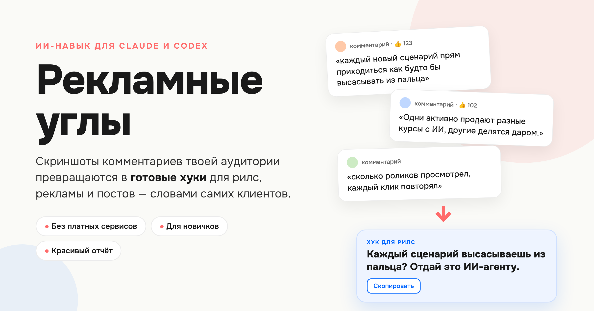
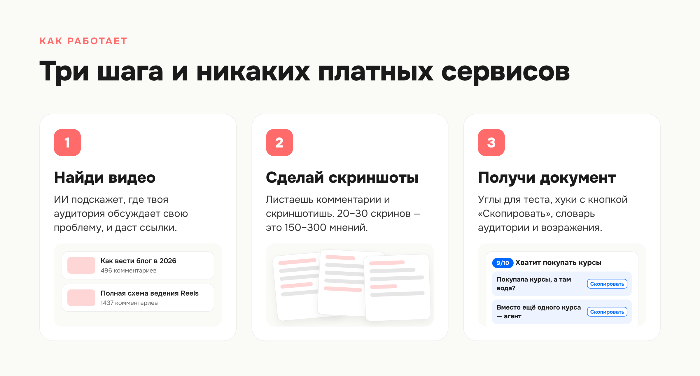
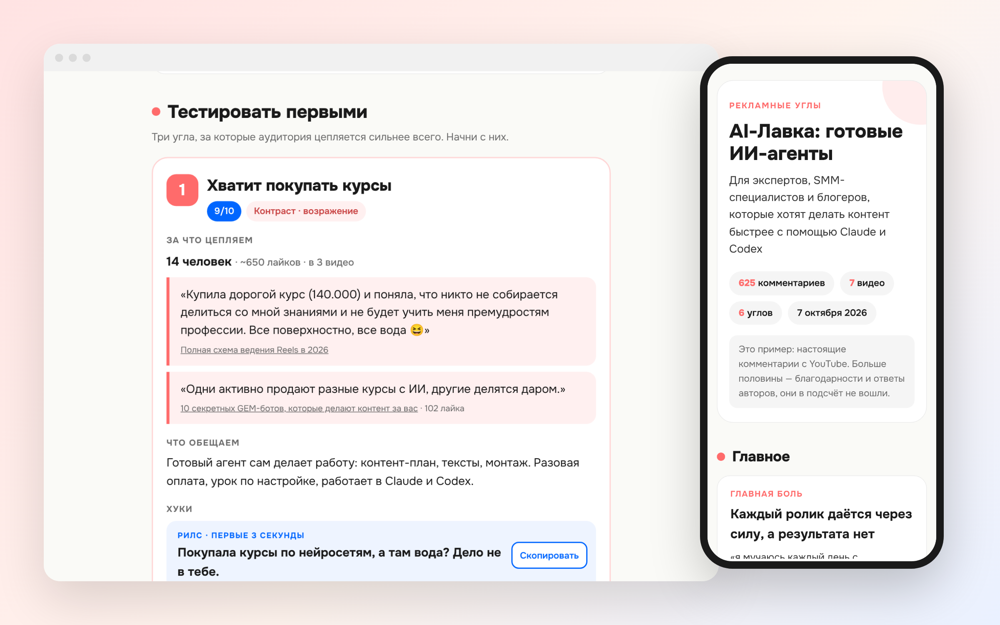

# Рекламные углы



**ИИ-навык для Claude и Codex: берёт комментарии твоей аудитории и превращает их в рекламные углы и готовые хуки — словами самих клиентов.**

   

Лучшие рекламные тексты не придумывают — их забирают у клиентов. Дословно. Из того, как люди сами описывают свою проблему в комментариях под видео, в отзывах и на форумах.

Навык делает это за тебя: подсказывает, где искать комментарии, читает их со скриншотов, считает, что повторяется снова и снова, и собирает красивый документ, с которым можно сразу идти тестировать рекламу.

## Как это работает



1. **Найди видео.** Пишешь, что продаёшь и кто твои клиенты. ИИ подсказывает, где твоя аудитория обсуждает свою проблему, и даёт ссылки.
2. **Сделай скриншоты.** Открываешь видео, листаешь комментарии и скриншотишь. 20–30 скриншотов — это 150–300 мнений. Займёт 5–10 минут.
3. **Получи документ.** ИИ читает скриншоты, склеивает похожие мнения в группы, считает, сколько людей пишут об одном и том же, и собирает отчёт.

## Что внутри отчёта



- **Главное** — главная боль, желание и возражение аудитории, с цитатами.
- **3 угла, которые тестировать первыми** — с оценкой и доказательствами: сколько человек об этом пишут, дословные цитаты.
- **Хуки** для рилс, рекламы и постов. У каждого кнопка «Скопировать».
- **Словарь аудитории** — фразы, которыми клиенты сами называют проблему.
- **Возражения и что ответить.**
- **Чего не хватает в продукте** — боли, которые продукт пока не решает. Подсказка, что доработать.
- **План теста** — как проверить углы без лишних трат.

Отчёт открывается в любом браузере, хорошо читается с телефона и сохраняется в PDF.

👉 [Посмотреть пример отчёта](https://htmlpreview.github.io/?https://github.com/mamamoz/ad-angles/blob/main/examples/example-ai-lavka.html) — собран на 625 настоящих комментариях с YouTube.

## Три способа собрать комментарии

| Способ | Для кого | Что нужно |
|---|---|---|
| **Скриншоты** | для всех | ничего — только руки и 10 минут |
| **Текстом** | если удобнее копировать | выделить комментарии и вставить в чат |
| **Сам в браузере** | если подключён Claude in Chrome | ИИ сам открывает видео и читает комментарии |
| **Apify** | для продвинутых | аккаунт Apify, собирает 500+ комментариев автоматически |

Навык сам поймёт, что у тебя есть, и предложит подходящий способ.

## Установка

**Claude (сайт или приложение)**

1. Скачай [ad-angles.zip](dist/ad-angles.zip). Не распаковывай.
2. Открой «Настроить» → «Навыки» (Customize → Skills).
3. Нажми «+» → «Создать навык» → «Загрузить навык» и выбери архив.

**Claude Code** — отправь сообщение:

```text
Установи навык из репозитория https://github.com/mamamoz/ad-angles в мои навыки Claude Code.
```

**Codex** — отправь сообщение:

```text
Установи навык из репозитория https://github.com/mamamoz/ad-angles в мои навыки Codex.
```

## Как запустить

```text
Найди рекламные углы для моего продукта.
Продукт: онлайн-консультации психолога по выгоранию
Аудитория: женщины 30–45, работают в найме, устали
```

```text
Вот скриншоты комментариев из трёх видео. Разбери и собери углы для моего курса по рилс.
```

```text
Разбери отзывы на моих конкурентов и найди, за что их ругают.
```

## Принцип честности

- Каждая цитата — дословная, с источником. Навык не придумывает цитаты, цифры и кейсы.
- Частота решает: один злой комментарий — шум, одно и то же у десяти человек — стратегия.
- Угол предлагается, только если продукт реально закрывает эту боль. Остальное идёт в раздел «Чего не хватает в продукте».

## Структура

```text
ad-angles/
├── SKILL.md                      # Главная инструкция навыка
├── УСТАНОВКА.md                  # Установка простыми словами
├── agents/openai.yaml            # Название и иконка для Codex
├── assets/
│   ├── report-template.html      # Шаблон красивого отчёта
│   ├── icon.png
│   └── hero.png
├── references/
│   ├── screenshots.md            # Как читать скриншоты комментариев
│   ├── sources.md                # Где искать аудиторию
│   ├── angle-types.md            # 8 типов углов и как писать хуки
│   └── apify.md                  # Автосбор для продвинутых
├── examples/                     # Пример готового отчёта
└── dist/ad-angles.zip            # Архив для загрузки в Claude
```

---

Сделано [@mama_mozg](https://t.me/marketing_dir) — Маргарита, ИИ-маркетинг без сложностей.
